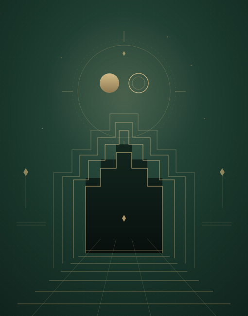

# The Twins of Xibalba

*An Epic Poem in Seven Books*

  

> *“Beneath the mountains, cold and deep,  
> Where ancient kings their councils keep,  
> Where roots through halls of darkness creep,  
> And rivers through the silence sweep,  
> There lie the courts of Xibalba.”*

📖 **[Read the Web Edition on GitHub Pages](https://gavindean90.github.io/the-twins-of-xibalba/)**

---

## Overview

**The Twins of Xibalba** is an epic narrative poem retelling the legendary descent of the Hero Twins—**Hunahpu** and **Xbalanque**—into the Maya underworld of Xibalba, drawn from the foundational mythology of the K'iche' Maya *Popol Vuh*.

Summoned beneath the earth by the Lords of Death after their ballplaying disturbs the underworld, the twin brothers must navigate treacherous games and lethal houses of blades, beasts, and cold, defeat the scheming death lords through wit and magic, and ultimately ascend into the heavens as the Sun and the Moon.

---

## Table of Contents

| Book | Title | Web Edition | Markdown Edition | Synopsis |
| :--- | :--- | :---: | :---: | :--- |
| **Book I** | **The Summons** | [Read Online](book-1.html) | [book-1.md](book-1.md) | The Hero Twins' ballgame awakens the lords below; messengers deliver the fatal summons to descend into Xibalba. |
| **Book II** | **The Descent** | [Read Online](book-2.html) | [book-2.md](book-2.md) | The journey past rivers of blood and pus, crossing crossroads, identifying the seated lords, and surviving the test of torch and cigar. |
| **Book III** | **The Houses of Death** | [Read Online](book-3.html) | [book-3.md](book-3.md) | The deadly ballgame against the lords; trials in the House of Knives, the House of Cold, the House of Jaguars, and the lethal House of Bats. |
| **Book IV** | **The Borrowed Head** | [Read Online](book-4.html) | [book-4.md](book-4.md) | Hunahpu is decapitated by Camazotz; Xbalanque carves a substitute head from a gourd, dupes the lords on the ballcourt, and restores his brother. |
| **Book V** | **The Fire and the Resurrection** | [Read Online](book-5.html) | [book-5.md](book-5.md) | The brothers knowingly leap into the great fiery pit; their ground bones are cast into water and reborn as wandering miracle workers. |
| **Book VI** | **The Fall of the Lords of Death** | [Read Online](book-6.html) | [book-6.md](book-6.md) | Disguised as poor conjurers, the twins amaze the kings with resurrection tricks, trick One Death and Seven Death into their own demise, and destroy the court's power. |
| **Book VII** | **The Ascension** | [Read Online](book-7.html) | [book-7.md](book-7.md) | The brothers honor their forebears, leave the ruins of Xibalba behind, and ascend into the cosmos as the Sun and the Moon, accompanied by the stars. |

---

## Form and Poetics

The epic is composed in a strict 9-line stanza form, predominantly in iambic tetrameter, with an embedded refrain:

- **Rhyme & Meter**: Each 9-line stanza opens with four rhymed tetrameter verses, resolves into an underworld refrain ending in *Xibalba*, continues with three rhymed tetrameter verses, and concludes with a second terminal refrain in *Xibalba*.
- **Scope**: Across the seven books, the epic spans **140 stanzas** and **1,260 verses** of continuous narrative poetry.

---

## License

This work is dedicated to the public domain under the [Creative Commons CC0 1.0 Universal Public Domain Dedication](LICENSE). You are free to copy, modify, distribute, perform, or adapt this work, even for commercial purposes, without asking permission.
